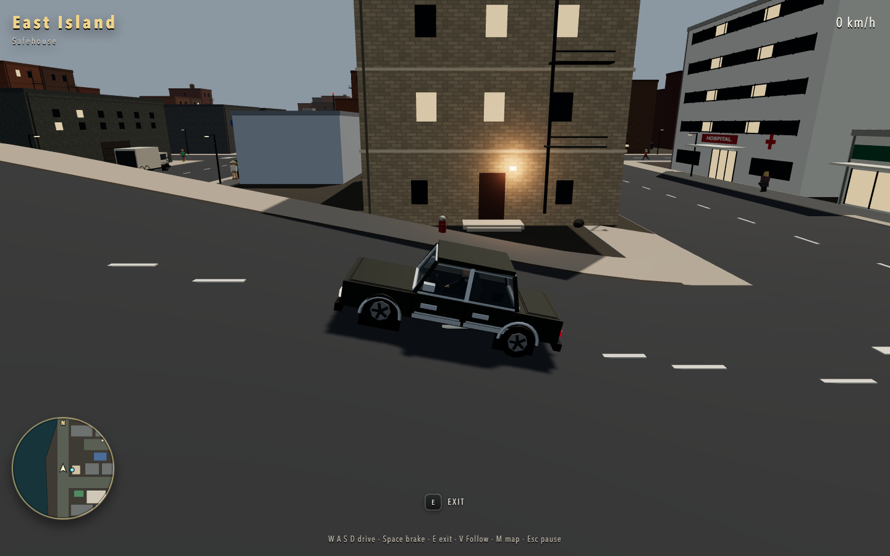
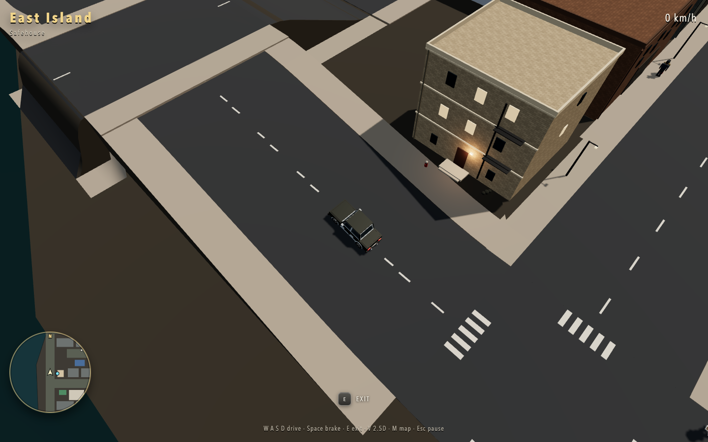

# retroGTA

[中文](README.zh.md)

A GTA-like game prototype built with Three.js. The map lives in a JSON file and the geometry is generated in code. The playable area is the east island.

## Screenshots

Follow camera and the fixed 2.5D camera, on the street outside the safehouse.

<p>
  
  
</p>

## Features

- Walk, run, enter and exit vehicles, drive, and brake
- Three cameras: follow, top-down, and 2.5D
- Pedestrians: hand-placed walkers from the map, plus a streamed crowd of 12 kinds that walks the sidewalk network, waits for traffic, dodges cars, chats, and idles
- Ambient traffic: cars drive right-hand lanes around city blocks, follow each other, stop for pedestrians and the player, and can be carjacked
- Building collision; people and cars follow the ground height; movement stays on walkable ground
- GTA-style radar minimap, plus a full-island map in the pause menu
- Main menu (Start, Settings, About) with rebindable keys saved in the browser
- Pause menu (Esc): map, controls, language, cheats, restart, and exit
- Cheats spawn a chosen vehicle beside the player; restart removes them
- English and Chinese interface

## Run

Node.js 18 or newer.

```bash
npm install
npm run dev
```

Open the local address printed in the terminal (default `http://127.0.0.1:5173/`).

```bash
npm run build    # writes dist/
npm run preview  # serves the build
make             # same build, writes dist/
make single      # one file, dist/retrogta.html
```

## Controls

Choose Start on the main menu. In the follow camera, move the mouse to look around. Esc pauses; press it again to resume, then click the picture to lock the pointer. The top-down and 2.5D cameras are fixed, and movement keys move relative to the screen.

Rebind keys in Settings (main menu) or Controls (pause menu): click a binding and press the new key. Esc cancels. A key already used by another action swaps with it. Reset keys restores the defaults. Bindings are saved in the browser, and Esc always pauses.

| Key | On foot | Driving |
| --- | --- | --- |
| W A S D | Move relative to the camera | Throttle, brake / reverse, steer |
| Shift | Run | — |
| Mouse | Turn the follow camera | Turn the follow camera |
| V | Cycle follow, top-down, and 2.5D | Cycle follow, top-down, and 2.5D |
| E | Walk to the nearest door, open it, and get in | Exit when moving slowly |
| Space | — | Brake |
| Esc | Pause: map, controls, language, cheats, restart, or exit | Pause: map, controls, language, cheats, restart, or exit |

The round radar at the bottom left shows the area around the player and rotates so the player faces up; driving fast widens the view. The arrow is the player, the cyan dot is the safehouse, and white dots are parked vehicles. Moving traffic and pedestrians are not shown. The pause map shows the whole island with north up. While driving, the top-right readout shows speed in km/h; reverse speed is negative.

## Interface language

Switch the interface in Settings on the main menu, or Language in the pause menu. The choice is saved in the browser.

- English (`en`) — default
- Chinese (`zh`)

## Map data

Y is up, +X is east, and +Z is south. The island lives in [`data/saint-marks.json`](data/saint-marks.json); `src/city.js` reads it and builds the meshes. People and cars follow the surface height and can stand only on the island, the bridge deck, or the landing. The safehouse sits at the foot of the riverside avenue on the west side, with its door facing west toward the slope.

| Element | Notes |
| --- | --- |
| `roads` | Orthogonal road grid. Sidewalks, crosswalks, street lamps, and the ambient traffic lane loops are generated along it |
| `blocks` | `residential` places row houses on the north and south edges. `industrial` places two south-facing warehouses. `alley` adds two dumpsters in the gap |
| `rows` | A named house row: width, floors, wall color, shop, awning, fire escape, roof tank |
| `safehouse` | One safehouse; the file includes it |
| `hill` | The slope and the raised intersection outside the safehouse |
| `island`, `beach`, `landing` | Coast, sand, and the far side of the bridge |
| `diagonals` | Diagonal roads |
| `bridge` | One bridge, deck at road height, with side towers |
| `water` | One water plane |
| `elevated`, `train` | An elevated track and a train that shuttles along it |
| `gate` | One gate and a short approach road |
| `trees` | Placed trees |
| `safehouseProps` | `marker`, `hydrant`, and `trash` |
| `vehicles` | 15 types; see [Vehicles](#vehicles). Unknown types fall back to `sedan`. Every parked vehicle can be entered; `driveable` marks the car the player starts next to. Ambient traffic can be carjacked too |
| `pedestrians` | Fixed people who walk a path, with shirt, pants, and an optional cap. Separate from the runtime crowd; see [Pedestrians](#pedestrians) |
| `bounds` | The reader accepts extra collision walls. The current map leaves this field out |

A position can be an absolute `x` / `z`, an offset from the safehouse door (`dx` / `dz`), or a `lane` (`curbNorth`, `pedSouth`, `sidewalkWest`, and so on). Vehicle and pedestrian `heading` values are degrees.

## Vehicles

Set the type with `vehicles[].type`. All builders live in `src/vehicle.js`; unknown types fall back to `sedan`.

| `type` | Vehicle | Notes |
| --- | --- | --- |
| `sedan` | Sedan | Four-door three-box car, the default; the car the player starts next to |
| `taxi` | Taxi | Sedan body with a roof sign |
| `hatchback` | Hatchback | Short body with a liftback tailgate |
| `suv` | SUV | Tall body, roof rails, larger wheels |
| `pickup` | Pickup | Separate cab and open cargo bed |
| `sports` | Sports car | Low body, fastback glass, rear wing |
| `van` | Van | Tall enclosed cargo body |
| `bus` | City bus | 10.6 m body, long side windows, two doors |
| `truck` | Box truck | Cab-over cab, large cargo box, dual rear wheels |
| `excavator` | Excavator | Tracks, boom, arm, and bucket |
| `tractor` | Tractor | Large rear wheels, small front wheels, roll bar, exhaust stack |
| `ambulance` | Ambulance | White box body, red stripe, red cross, light bar |
| `firetruck` | Fire truck | Red body, equipment box, roof ladder, light bar, six wheels |
| `police` | Police car | Blue-and-white livery with a red/blue roof light bar |
| `mixer` | Cement mixer | Tilted drum, reinforcing rings, rear discharge chute, six wheels |

To add a type, write a builder in `src/vehicle.js`, register it in `BUILDERS`, and set the matching `type` on an entry in `data/saint-marks.json`.

## Pedestrians

The crowd draws from the kinds in `src/npc.js`. Hand-placed pedestrians in the map keep their own shirt, pants, and cap colors and walk their own paths.

| Kind | Pedestrian | Notes |
| --- | --- | --- |
| `businessman` | Businessman | Suit, tie, briefcase, short hair, sometimes a cap. Medium pace |
| `businesswoman` | Businesswoman | Blazer, skirt, handbag, long hair. Tights or bare legs, sometimes glasses |
| `student` | Student | Hoodie or casual top, jeans or shorts, backpack, cap or beanie, headphones |
| `schoolkid` | Schoolchild | Shorter and larger-headed, bright backpack and shorts. Faster than adults |
| `tourist` | Tourist | Bright shirt, shorts, sun hat, backpack or tote. Walks slowly |
| `jogger` | Jogger | Sleeveless top, shorts, sneakers, headphones. The fastest walker |
| `constructionWorker` | Construction worker | Heavy build, hi-vis vest, hard hat, work boots |
| `elderly` | Elderly person | Hunched, gray or white hair, cane, beanie or cap, glasses. The slowest |
| `courier` | Courier | Uniform shirt and cap, large backpack. Brisk pace |
| `shopper` | Shopper | Casual clothes, tote bag or handbag. Varied builds and hair |
| `policeOfficer` | Police officer | Navy uniform, police cap, belt. Rare |
| `punk` | Punk | Dyed hair, beanie, dark clothes, headphones |

Weights in `KINDS` decide how often a kind appears; each spawn also rolls height, build, skin, hair, and clothing colors. To add a kind, append an entry to `KINDS` with a `weight` and a `make()` that returns the actor options (see the existing entries for the fields).

The crowd reacts to traffic: people wait at the curb while a car comes through the crossing, hurry across if one approaches mid-crossing, and jump aside when a car heads straight for them on the sidewalk. Two walkers who meet sometimes stop to chat, and idle people look around, check a phone, or window-shop at the nearest shopfront. Hand-placed map pedestrians also run from a car driving straight at them.

## Traffic

`src/city.js` derives a clockwise lane loop around each city block whose four sides are unbroken roads. Cars drive the right-hand lane of each loop, so neighboring blocks give two-way traffic. They slow for corners, follow moving cars and the player's car, and stop for pedestrians or for the player standing in the road. Cars spawn and despawn only outside the camera, like the pedestrian crowd. Ambient cars can be carjacked: target one with E and it stops while you walk to the door. Once taken, it becomes a normal car and can be parked or driven like any other.

## Project layout

| File | Role |
| --- | --- |
| `src/main.js` | Entry point |
| `src/menu.js` | Main menu: Start, Settings, About |
| `src/game.js` | Loop, cameras, walking and driving, HUD |
| `src/city.js` | Builds roads, buildings, the elevated track, colliders, and the lane/sidewalk networks |
| `src/config.js` | Metrics exported from the map file, plus a stable hash |
| `src/actor.js` | Low-poly person model, walk cycle, and seated pose |
| `src/npc.js` | Pedestrian kinds, sidewalk graph, and the streamed crowd |
| `src/traffic.js` | Block lane loops, ambient traffic, and car following |
| `src/vehicle.js` | Vehicle meshes, driving state, doors, and the 15 builders |
| `src/collision.js` | Circle collision on the ground, plus the walkable island and bridge |
| `src/materials.js` | Brick and sign textures drawn on a canvas |
| `src/i18n.js` | English and Chinese interface strings |
| `src/bindings.js` | Key bindings, saved in the browser |
| `src/input.js` | Keyboard and pointer lock |
| `src/minimap.js` | Radar minimap and the full-island pause map |
| `src/style.css` | HUD styles |
| `index.html` | Page shell and HUD markup |
| `data/saint-marks.json` | Map: roads, blocks, landmarks, vehicles, and pedestrians |
