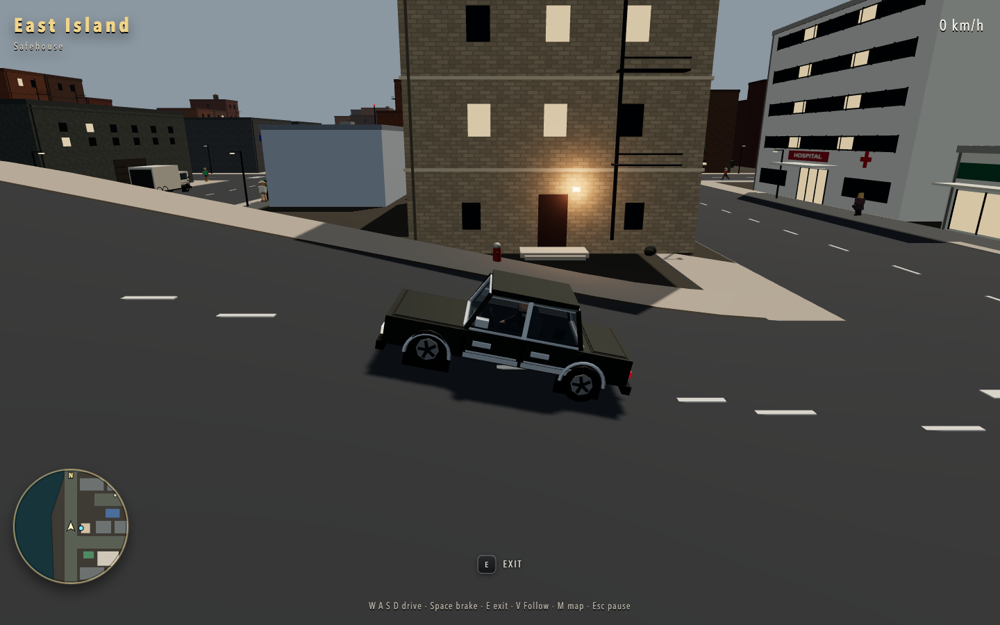
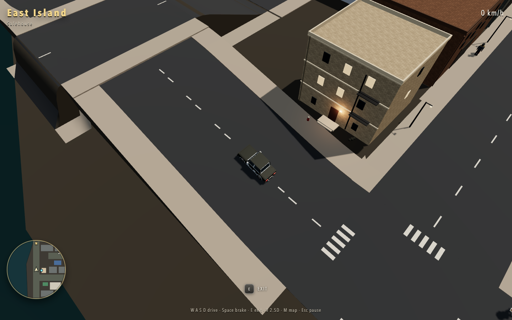

# retroGTA

[English](README.md)

用 Three.js 做的类 GTA 游戏原型。地图写在 JSON 里，场景几何由代码生成，当前可玩范围是东岛。

## 截图

安全屋外的街道。左图是跟随视角，右图是固定的 2.5D 视角。

<p>
  
  
</p>

## 功能

- 徒步、奔跑、跳跃、徒手攻击、上下车、驾驶和刹车
- 跟随、俯视、2.5D 三种视角
- 路人：地图里手摆的固定路人，加上 12 种围绕玩家流式生成的路人群，会走人行道、等车、躲车、聊天和驻足
- 环境车流：车辆按右侧车道绕街区行驶，会跟车、给行人和玩家让行，也可以抢
- 建筑碰撞；人和车跟随地面高度；活动范围限制在可走地面上
- GTA 风格圆形雷达小地图，以及暂停菜单里的全岛地图
- 情境按键提示（上车、抢车、下车）；完整操作提示会在开场几秒后自动淡出
- 主菜单：开始、设置、关于；按键可重绑，选择记在浏览器里
- 暂停菜单（Esc）：地图、按键设置、切换语言、作弊、重新开始、退出
- 作弊可以选一辆车刷到玩家旁边，重新开始会清掉这些车
- 英文和中文界面

## 运行

需要 Node.js 18+。

```bash
npm install
npm run dev
```

浏览器打开终端里的本地地址（默认 `http://127.0.0.1:5173/`）。

```bash
npm run build    # 输出到 dist/
npm run preview  # 预览构建结果
make             # 同样打包到 dist/
make single      # 打成单个文件 dist/retrogta.html
```

## 操作

在主菜单选择开始。跟随视角下用鼠标转镜头。按 Esc 暂停，再按 Esc 继续，然后点击画面重新锁定鼠标。俯视和 2.5D 镜头固定，移动键按画面方向走。

在主菜单的设置里，或暂停菜单的按键设置里，可以重绑按键：点一个按键，再按下新键或鼠标按键。Esc 取消。如果这个键已经被别的动作占用，两个动作对调。恢复默认回到下表。选择记在浏览器里；Esc 始终用来暂停。

| 按键 | 徒步 | 驾驶 |
| --- | --- | --- |
| W A S D | 相对镜头移动 | 油门、刹车 / 倒车、转向 |
| Shift | 奔跑 | — |
| 鼠标 | 跟随视角下转动镜头 | 跟随视角下转动镜头 |
| V | 跟随、俯视、2.5D 之间切换 | 跟随、俯视、2.5D 之间切换 |
| E | 走向最近的车门，开门后上车 | 车速较低时下车 |
| 空格 | 跳跃 | 刹车 |
| 鼠标左键 | 徒手攻击 | — |
| Esc | 暂停：地图、按键设置、切换语言、作弊、重新开始、退出 | 暂停：地图、按键设置、切换语言、作弊、重新开始、退出 |

左下角圆形雷达只显示玩家周围的一片区域，并随朝向旋转，车头始终朝上；开车越快视野越宽。箭头是玩家，青色圆点是安全屋，白点是停放的车辆；行驶中的环境车流和路人不显示。暂停菜单里的地图能看到整座岛，北朝上。开车时右上角显示速度（km/h，倒车为负数）。

## 界面语言

在主菜单的设置里，或暂停菜单的切换语言里，可以换界面语言。选择记在浏览器里。

- 英文（`en`）— 默认
- 中文（`zh`）

## 地图数据

坐标：Y 朝上，+X 朝东，+Z 朝南。整座东岛写在 [`data/saint-marks.json`](data/saint-marks.json)，`src/city.js` 读取这份数据再生成模型。人和车跟随路面高度，也只能站在岛、桥面或桥头上。安全屋在西侧靠河大道的坡底，门朝西对着这条上坡路。

| 元素 | 说明 |
| --- | --- |
| `roads` | 正交路网。人行道、斑马线、路灯和环境车流的车道环线沿路自动生成 |
| `blocks` | `residential` 在街坊南北两边放联排住宅，`industrial` 放两座朝南的仓库。`alley` 会在中间巷子放两只垃圾箱 |
| `rows` | 手摆的一排房子：宽度、层数、墙色、底商、雨棚、消防梯、屋顶水箱 |
| `safehouse` | 一座安全屋，当前地图已填写 |
| `hill` | 安全屋外的上坡和坡顶小路口 |
| `island`、`beach`、`landing` | 海岸、沙滩、桥对岸空地 |
| `diagonals` | 斜路 |
| `bridge` | 一座大桥，桥面与路面同高，两侧有桥塔 |
| `water` | 一块水面 |
| `elevated`、`train` | 高架，以及在上面来回开的列车 |
| `gate` | 一座牌楼和一小段引道 |
| `trees` | 可摆放的树 |
| `safehouseProps` | `marker`（存档光环）、`hydrant`（消防栓）、`trash`（垃圾桶） |
| `vehicles` | 15 种车型，详见下方[车型](#车型)。未知类型按轿车处理。地图里停放的车辆都可以开，`driveable` 标出玩家初始旁边的那辆；环境车流也可以抢 |
| `pedestrians` | 沿路径走动的固定路人，可配上衣、裤子和帽子。和运行时生成的路人群各自独立，见[路人](#路人) |
| `bounds` | 读取代码接受额外碰撞墙。当前地图没有填写这一项 |

位置可以用绝对的 `x` / `z`，或相对安全屋门的 `dx` / `dz`，或 `lane`（`curbNorth`、`pedSouth`、`sidewalkWest` 等）。车和路人的 `heading` 用角度。

## 车型

车型由 `vehicles[].type` 指定，构建函数集中在 `src/vehicle.js`。未知的 `type` 会回退为 `sedan`。

| `type` | 车型 | 说明 |
| --- | --- | --- |
| `sedan` | 轿车 | 四门三厢，默认车型；当前地图玩家初始旁边的那辆 |
| `taxi` | 出租车 | 轿车车身 + 车顶灯牌 |
| `hatchback` | 两厢车 | 短车身、掀背尾门 |
| `suv` | SUV | 高车身、车顶行李架、大轮子 |
| `pickup` | 皮卡 | 独立驾驶舱 + 敞开货斗 |
| `sports` | 跑车 | 低趴车身、溜背玻璃、尾翼 |
| `van` | 厢式车 | 高顶封闭货厢 |
| `bus` | 公交 | 10.6 米长车身、长条侧窗、双车门 |
| `truck` | 厢式货车 | 平头驾驶室 + 大货箱、后双轮 |
| `excavator` | 挖掘机 | 履带底盘、动臂、斗杆、铲斗 |
| `tractor` | 拖拉机 | 大后轮、小前轮、防滚架、排气管 |
| `ambulance` | 救护车 | 白色厢体、红色腰线、红十字、警灯 |
| `firetruck` | 消防车 | 红色车身、设备厢、车顶梯、警灯、六轮 |
| `police` | 警车 | 蓝白涂装、车顶红蓝警灯 |
| `mixer` | 水泥搅拌车 | 倾斜搅拌罐、加强环、尾部卸料溜槽、六轮 |

新增车型时，在 `src/vehicle.js` 里写一个构建函数，注册到 `BUILDERS`，再在 `data/saint-marks.json` 的 `vehicles` 里填写 `type` 即可。

## 路人

运行时路人群从 `src/npc.js` 的 `KINDS` 里按权重抽取。`data/saint-marks.json` 里手摆的固定路人保留自己的上衣、裤子、帽子配色，并沿自己的路径行走。

| 类型 | 路人 | 说明 |
| --- | --- | --- |
| `businessman` | 上班族（男） | 西装、领带、公文包、短发，偶尔戴帽子。中等步速 |
| `businesswoman` | 上班族（女） | 西装外套、裙子、手提包、长发。长裤袜或光腿，部分戴眼镜 |
| `student` | 学生 | 连帽衫或休闲上衣、牛仔裤或短裤、双肩包、帽子或毛线帽、耳机 |
| `schoolkid` | 小孩 | 个子矮、头更大，亮色书包和短裤。比成年人走得快 |
| `tourist` | 游客 | 花色上衣、短裤、遮阳帽、背包或手提袋。走得慢 |
| `jogger` | 慢跑者 | 无袖上衣、短裤、运动鞋、耳机。步速最快 |
| `constructionWorker` | 建筑工人 | 壮体型、反光背心、安全帽、劳保鞋 |
| `elderly` | 老人 | 驼背、灰白头发、拐杖、毛线帽或帽子、眼镜。步速最慢 |
| `courier` | 快递员 | 制服上衣和帽子、大背包。步速较快 |
| `shopper` | 购物者 | 休闲装、购物袋或手提包。体型和发型多样 |
| `policeOfficer` | 警察 | 深蓝制服、警帽、腰带。出现频率低 |
| `punk` | 朋克 | 染发、毛线帽、深色衣服、耳机 |

`KINDS` 里的 `weight` 决定出现频率，每次生成还会随机身高、体型、肤色、发色和服装配色。新增类型时，在 `KINDS` 里加一项，写 `weight` 和返回角色外观参数的 `make()` 即可（字段可参考现有条目）。

路人群会对交通做出反应：有车要经过斑马线时，行人会在路边等车过去；走到一半发现来车会加速穿过；车直冲人行道时会闪身躲开。被玩家拳头打中的附近路人会受惊跑开。两个人迎面走过时偶尔会停下来聊几句；驻足时还会四处张望、看手机，或者面向最近的店铺橱窗。地图里手摆的固定路人也会躲开迎面开来的车。

## 环境车流

`src/city.js` 会为每条四边道路都完整的街区生成一条顺时针车道环线。车辆沿环线靠右行驶，相邻街区合起来就形成双向车流。车会在转弯前减速，跟随前方车辆和玩家的车，遇到行人或站在车道上的人会停车。和路人一样，车辆只在摄像机画面外生成和销毁。环境车流也可以抢：对着车按 E，它会停下来等你走到车门边，抢到后就变成一辆普通车辆，可以随便开或停在路边。

## 目录结构

| 文件 | 作用 |
| --- | --- |
| `src/main.js` | 启动入口 |
| `src/menu.js` | 主菜单：开始、设置、关于 |
| `src/game.js` | 主循环、镜头、徒步 / 驾驶、界面 |
| `src/city.js` | 生成道路、建筑、高架、碰撞，以及人行道和车道网络 |
| `src/config.js` | 从地图文件导出尺寸，以及确定的随机数 |
| `src/actor.js` | 低模人物模型、走路动画和坐姿 |
| `src/npc.js` | 路人类型、人行道图和流式路人群 |
| `src/traffic.js` | 街区车道环线、环境车流和跟车逻辑 |
| `src/vehicle.js` | 车辆模型、驾驶状态、车门和 15 种构建函数 |
| `src/collision.js` | 水平面上的圆形碰撞，以及岛和桥的可走范围 |
| `src/materials.js` | 砖纹和招牌（Canvas 贴图） |
| `src/i18n.js` | 英文和中文界面文案 |
| `src/bindings.js` | 按键设置，记在浏览器里 |
| `src/input.js` | 键盘和鼠标锁定 |
| `src/minimap.js` | 圆形雷达小地图和暂停菜单的全岛地图 |
| `src/style.css` | 界面样式 |
| `index.html` | 页面结构和 HUD |
| `data/saint-marks.json` | 地图数据：路网、街坊、地标、车辆和路人 |
